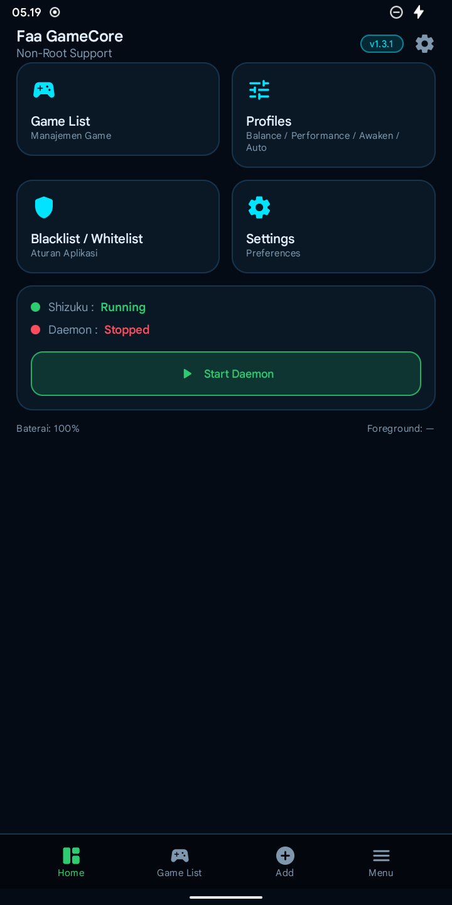
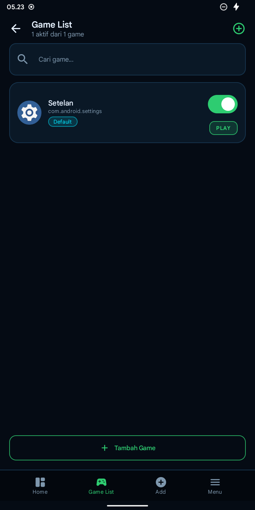
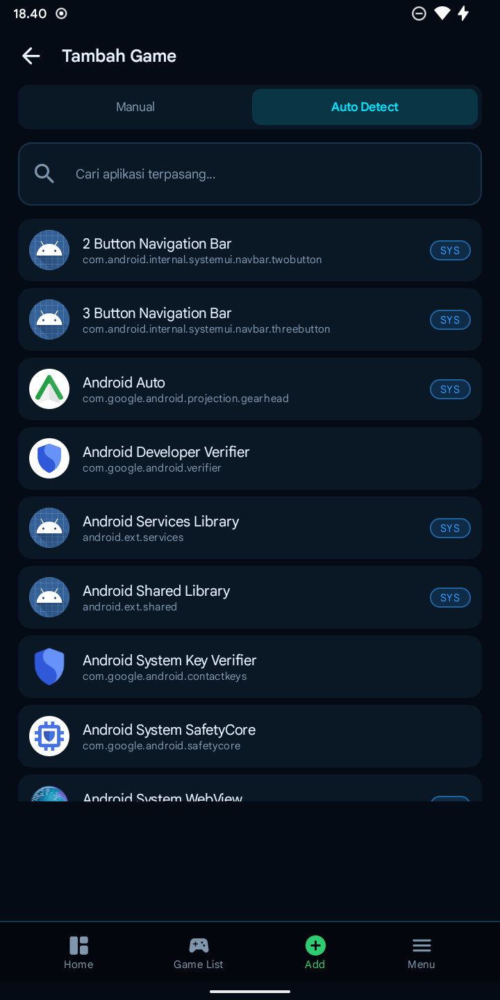
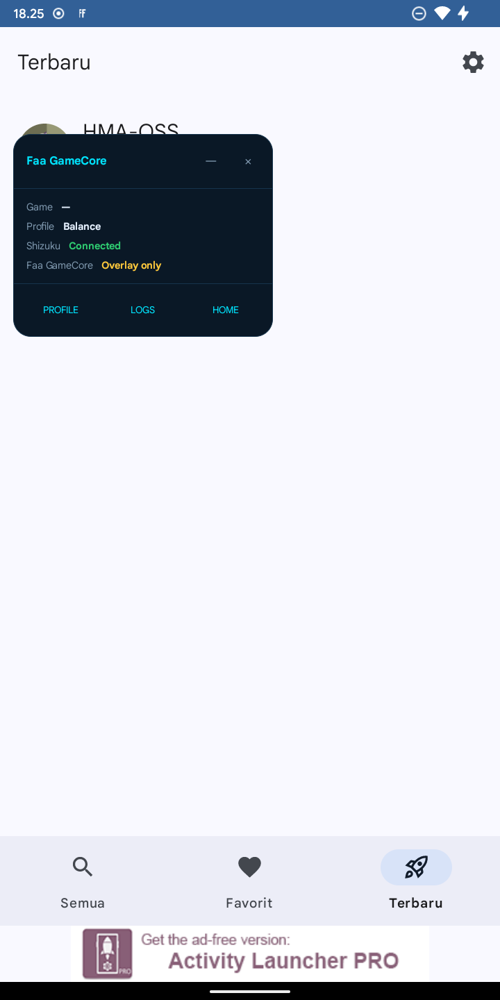

# Faa GameCore — Built-In

[](https://github.com/FaaRamadhann/GameCore-BuiltIn/releases/latest)
[](LICENSE)
[-3ddc84?logo=android&logoColor=white)](#persyaratan)
[](#persyaratan)

Aplikasi Android native **non-root** untuk mengatur aplikasi latar belakang saat bermain game.
Logika inti [Faa GameCore](https://github.com/FaaRamadhann/Faa-GameCore) (modul Magisk) dijalankan
ulang sebagai aplikasi mandiri di atas **Shizuku** — tanpa root, tanpa Magisk, tanpa `su`.

> **Unduh:** [app-release.apk (v1.3.1)](https://github.com/FaaRamadhann/GameCore-BuiltIn/releases/latest/download/app-release.apk)

<p align="center">
  
  
  
  
</p>

---

## Daftar isi

- [Kenapa Built-In](#kenapa-built-in)
- [Fitur](#fitur)
- [Cara kerja](#cara-kerja)
- [Persyaratan](#persyaratan)
- [Instalasi](#instalasi)
- [Build dari source](#build-dari-source)
- [Pengujian](#pengujian)
- [Batasan](#batasan)
- [Struktur proyek](#struktur-proyek)
- [Lisensi](#lisensi)

## Kenapa Built-In

Versi modul Magisk menempel ke sistem lewat Zygisk/`/data/adb`. Versi ini mengambil jalur yang
lebih sederhana: seluruh keputusan ada di aplikasi, dan perintah istimewa (`pm disable-user`,
`pm enable`, `am force-stop`, `dumpsys`) dijalankan sebagai **uid shell** lewat Shizuku.

Hasilnya: satu APK, bisa di-uninstall biasa, dan state paket tetap reversibel.

## Fitur

| Fitur | Keterangan |
|---|---|
| **Game List** | Tambah manual (validasi paket harus terpasang) atau pilih dari aplikasi terpasang |
| **Auto Detect** | Daftar seluruh aplikasi + pencarian + badge `SYS` untuk aplikasi sistem |
| **Profil 1 Balance** | Hanya `am force-stop` pada target |
| **Profil 2 Performance** | Force-stop lebih agresif |
| **Profil 3 Awaken** | Force-stop + `pm disable-user` (freeze sungguhan) |
| **Profil 4 Auto** | Dipilih otomatis dari level baterai |
| **Blacklist / Whitelist** | Whitelist menang; paket sistem selalu dilindungi |
| **Jurnal write-ahead** | Ditulis **sebelum** perintah disable, jadi tidak ada paket "hilang" |
| **Verifikasi jujur** | Snapshot `pm list packages -d/-e`; gagal → entry disimpan untuk retry |
| **Recovery** | Process death, daemon mati, sesi basi, dan boot |
| **Daemon** | Foreground service + notifikasi, poll interval |
| **Floating Overlay** | Panel + bubble, bisa digeser, start minimized, ganti profil dari panel |
| **Dry run** | Simulasi sesi penuh tanpa mengubah satu paket pun |
| **Runtime log** | Ring buffer + `fgc-runtime.log` |

## Cara kerja

```
UI (Jetpack Compose, tema "Night Blue Sky")
  └── Fgc (state flow + engine, satu pintu)
        ├── Policy       ← port policy_engine.sh + process_manager.sh + session_controller.sh
        ├── ShizukuBridge → IShizukuService.newProcess("sh -c …")   (uid shell)
        ├── Store        → SharedPreferences (games, black/whitelist, jurnal frozen)
        ├── Logs         → ring buffer + file (fgc-runtime.log)
        └── FgcService   → foreground service, poll foreground app (dumpsys)
```

Aturan yang dipertahankan dari sumber asli:

| Aturan | Implementasi |
|---|---|
| whitelist > blacklist | `Policy.targets()` memfilter whitelist lebih dulu |
| paket sistem tidak pernah dibekukan | `Policy.freeze()` + `Device.isSystem()` (fail-closed) |
| freeze reversibel | `pm disable-user` saat sesi, `pm enable` / `cmd package enable` saat selesai |
| jurnal write-ahead | `Store.frozen` ditulis **sebelum** perintah disable |
| verifikasi jujur | snapshot `pm list packages -d/-e`; gagal verifikasi → entry disimpan untuk retry |
| game foreground tidak dibekukan | target difilter terhadap paket game |
| dry-run | `Policy.freeze()` melewati perintah, hanya log |

## Persyaratan

- Android 8.0+ (API 26), targetSdk 34.
- **Shizuku Next** aktif — versi yang direkomendasikan
  ([rilis terbaru](https://github.com/rushiranpise/Shizuku-Next/releases/latest),
  paket `shizuku-v14.0.27-next.apk`). Diuji pada `14.0.26-next`.
  Shizuku resmi (13.x) juga jalan, tapi Next lebih andal untuk start via
  wireless debugging di Android 12+.
- Tidak butuh root, Magisk, atau LSPosed.

## Instalasi

1. Unduh [app-release.apk](https://github.com/FaaRamadhann/GameCore-BuiltIn/releases/latest/download/app-release.apk)
   dan buka di perangkat (izinkan "Install unknown apps" bila diminta), atau:
   ```bash
   adb install -r app-release.apk
   ```
2. Jalankan **Shizuku Next** lebih dulu (mode wireless debugging / ADB).
3. Buka **Faa GameCore** → Welcome → **Buka Shizuku** → izinkan Faa GameCore.
4. Kembali ke aplikasi → **Lanjutkan** → **Start Daemon**.
5. Tambah game di **Game List**, pilih profil, lalu tekan **PLAY**.

## Build dari source

Butuh JDK 17+ dan Android SDK (platform 34, build-tools 34+).

```bash
./gradlew :app:assembleDebug          # tanpa keystore
```

APK: `app/build/outputs/apk/debug/app-debug.apk`

Untuk build release, siapkan `keystore/keystore.properties` + file JKS (tidak ikut repo):

```properties
storeFile=keystore/fgc-release.jks
storePassword=…
keyAlias=…
keyPassword=…
```

```bash
./gradlew :app:assembleRelease
```

Detail toolchain, signing, dan daftar skrip uji ada di [`docs/BUILD.md`](docs/BUILD.md).

## Pengujian

Semua uji device dijalankan di **Redmi 6A, Android 12 (SDK 32)** dan berakhir `exit 0`:

| Uji | Bukti |
|---|---|
| Smoke test (semua layar, crash scan) | `build/smoke-last.log` |
| Freeze / unfreeze / process death / recovery | `build/freeze-test-last.log` |
| Boot recovery | `build/boot-test-last.log` |
| Floating overlay di atas aplikasi lain | `build/overlay-test-last.log` |
| Dry run tidak menyentuh paket | `build/dryrun-test-last.log` |
| Auto-detect + pencarian | `build/autodetect-test-last.log` |
| APK release: install, onboarding, cold start | `build/release-check-last.log` |
| Self-test host (policy, launcher, recovery, ikon) | `tools/check_*.py` |

Laporan lengkap: [`docs/TEST-REPORT.md`](docs/TEST-REPORT.md) · status per fitur:
[`docs/FEATURES.md`](docs/FEATURES.md) · catatan kerja: [`PROGRESS.md`](PROGRESS.md).

## Batasan

- **Overlay tidak bisa tampil di atas Setelan.** Android 12 memasang
  `mForceHideNonSystemOverlayWindow=true` untuk aplikasi yang meminta `HIDE_OVERLAY_WINDOWS`
  (anti-tapjacking). Perilaku platform, bukan bug aplikasi.
- Reboot fisik tidak diuji di perangkat uji (tidak mencapai `sys.boot_completed=1`); jalur boot
  diverifikasi lewat action debug di build debug dengan kode produksi yang sama.
- Non-root berarti ada batas keras: hook Zygisk/LSPosed, kill level kernel, `setenforce`,
  dan akses `/data/adb` tidak tersedia.

## Struktur proyek

```
app/src/main/java/com/faa/fgamecore/
  core/        Fgc, Policy, Store, Logs, Launcher, Recovery, OverlayService, FgcService, BootReceiver
  ui/          Compose: Dashboard, Games, Settings, Onboarding
docs/          BUILD, FEATURES, TEST-REPORT, SHIZUKU, screenshots
tools/         self-check host + harness ADB (freeze, boot, overlay, dry-run, auto-detect, release)
```

## Lisensi

GNU General Public License v3.0 or later — lihat [`LICENSE`](LICENSE).
Mengikuti proyek sumber [Faa GameCore](https://github.com/FaaRamadhann/Faa-GameCore).
